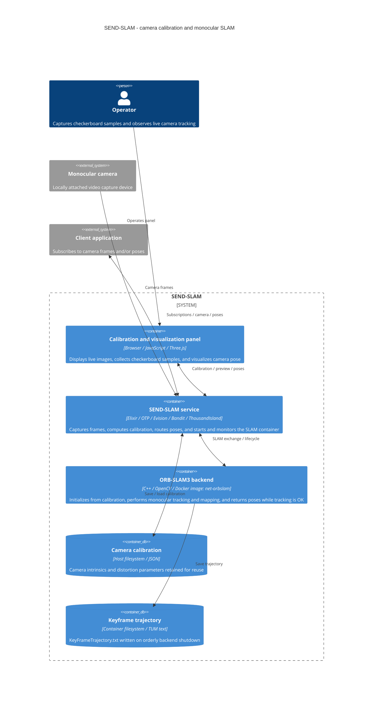

# SEND-SLAM architecture

C4 container view of the current monocular-camera proof of concept. SEND-SLAM captures camera frames, calibrates the camera, delegates simultaneous localization and mapping to ORB-SLAM3, and streams camera poses to a browser or a client application. Boxes represent runtime applications and file stores, not individual Elixir processes.

## Relationship details

Each pair of elements has a single arrow so bidirectional traffic and lifecycle operations do not place multiple labels on the same line. Protocol details are listed here rather than crowding the chart.

| Arrow label | Direction and function | Interface |
| --- | --- | --- |
| Operates panel | Operator captures checkerboard samples and views tracking in the browser. | Browser UI |
| Camera frames | Camera supplies images to the service. | Local capture through Evision / OpenCV |
| Calibration / preview / poses | Panel loads the page, subscribes to camera and pose streams, and submits calibration samples; service returns live JPEG frames and JSON poses. | HTTP `GET /`; WebSocket `/client` for subscriptions, samples, images, and poses; port **4000** |
| Save / load calibration | Service writes calibration parameters and reloads them at startup. | Host filesystem / JSON |
| SLAM exchange / lifecycle | Service starts, monitors, and restarts the backend through Docker. Backend opens the TCP connection; service sends calibration and timestamped PPM frames; backend returns poses when tracking is OK. | Docker CLI with host networking; TCP **5000**, 32-bit big-endian length-prefixed MessagePack |
| Subscriptions / camera / poses | External applications explicitly subscribe to camera and/or pose data and may submit calibration samples. The service sends binary JPEG frames and JSON poses only for subscribed streams. | WebSocket `/client`, port **4000** |
| Save trajectory | Backend writes keyframe trajectory on orderly shutdown. | Container-local `KeyFrameTrajectory.txt`, TUM format |

## Runtime details and caveats

- **Calibration:** the panel collects ten samples; the calibrator defaults to a 9 x 6 checkerboard with 25 mm squares. Calibration is broadcast to the camera producer and accompanies frames sent to the backend. The backend initializes ORB-SLAM3 from the received calibration before tracking.
- **Calibration file:** `CameraCalibrator.default_output_path/0` resolves to `send_slam/priv/calibration/latest.json`, unless `SEND_SLAM_CALIBRATION_FILE` overrides it.
- **Storage:** `DockerHandler` runs the backend with `--rm` and no volume mount. The trajectory is therefore container-local, not durable host storage. The wrapper does not implement persistent map loading/saving; the configured `ORBSLAM3_MAP_PATH` is not consumed by this backend source.
- **Backend connection:** the service listens on TCP port **5000**, but the Dockerfile defaults `ORB_SLAM3_WS_PORT` to **4000**. Set `ORBSLAM3_ORB_SLAM3_WS_PORT=5000` in the service environment; `DockerHandler` strips the `ORBSLAM3_` prefix and forwards `ORB_SLAM3_WS_PORT=5000` to the container. Despite its name, this setting controls raw TCP, not WebSocket. The diagram shows the required matching connection.
- **Scope:** this view shows the active camera path in `Application.start/2`. The commented-out video producer and separate pose server are not active containers. The browser and external applications use `/client` on port 4000 and explicitly subscribe to the streams they need.

## Implementation references

- Runtime composition: `send_slam/lib/send_slam/application.ex`
- Capture and calibration: `send_slam/lib/send_slam/camera_producer.ex`, `camera_calibrator.ex`, and `client_application_server.ex`
- HTTP/WebSocket interfaces: `send_slam/lib/send_slam/web_server.ex`, `client_application_server.ex`, and `send_slam/web/index.html`
- Backend protocol and pose routing: `send_slam/lib/send_slam/slam_handler.ex`
- Container lifecycle: `send_slam/lib/send_slam/docker_handler.ex` and `dockerfile`
- Tracking and trajectory output: `slam_backends/orb_slam_3/orbslam3_mono_networked.cc`
